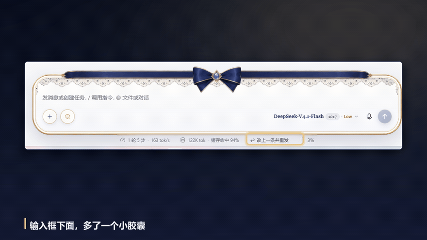

# dsh-rewind-resend

> 像 Codex 一样回头改：消息已经发出、回合已经在跑，也能撤回重写。

一个 DSH（DeepSeek Harness）桌面端插件。会话输入框底下会多出一个小胶囊「↩ 改上一条并重发」，点一下就把刚发的那条消息取回输入框，改完再发 —— 前面的历史一条不丢。



## 它做什么

点一下胶囊：

1. 当前回合还在跑？先把它停掉（等价于点 Stop，`session.cancel()`）；
2. 在**上一条消息之前**的最后一个完整回合边界上 fork 一个子会话 —— 子会话保留所有更早的回合，但不包含你要改的这条；
3. 在这个子会话上先 retain 拿到 binding，把原消息的文本预填进输入框（`clearPreviousDraft: true`），再 `openSession` 打开它 —— 和官方 `startSession` 的 `beforeOpen` 同序，草稿不会被后续挂载覆盖；
4. 你改完、按下发送即可。

原会话不会被删除，历史也还在：等价于「从这条消息处开一版新的」，和 Codex 的终止 → 改写 → 重发是同一个语义。

## 怎么用

装好之后日常就三步，全程在输入框附近完成：

1. **找胶囊** —— 输入框下面那一行状态栏，右边倒数第二个小胶囊写着「↩ 改上一条并重发」。
2. **点它** —— 只对**你最近发的那条**消息生效。点了之后：
   - 正在跑的回合立刻停（不用先按 Stop）；
   - 界面自动切到一个新会话（标题带 `(1)`），你那条消息的原文已经躺在输入框里，光标在末尾；
   - 上面的旧回答都还在。
3. **改完回车** —— 直接按 Enter 或点发送键，它带着原来的上下文接着答。

想放弃？新会话里什么都不做，回左侧点原来的会话就行，那边一点没动。

> 胶囊只在「有你说的消息」时出现；纯看不说、或还在第一轮之前的空会话里不会显示。

## 为什么是 fork 而不是原地编辑

宿主的会话日志是 append-only 的（`session/session-fork` 只接受「在某个 seq 处切一个前缀」），没有原地改写某条已提交消息的 RPC。所以唯一正确的做法是分叉出一个新会话，把旧上下文带过去 —— 这也是官方 UI 里「分支」按钮用的机制。

## 安装

### 前置条件

- Windows，已装 **DSH 桌面端**，并且至少启动过一次（profile 才会生成）；
- 有 `git`（用来克隆仓库）；
- 只需要系统自带的 Windows PowerShell 5.1，**不需要** PowerShell 7。

### 一行命令

在 PowerShell 里：

```powershell
git clone https://github.com/yangmingzhou-restart/dsh-rewind-resend.git
cd dsh-rewind-resend
powershell -ExecutionPolicy Bypass -File .\install.ps1
```

然后**重启 DSH 桌面端**（bundle 只在启动时进 boot graph，热重载不会加载它）。

脚本会把三件事一起做掉，重复跑也没关系（幂等）：

1. 在 `<profile>\node_modules` 里建一个指向本仓库的 junction；
2. 往 `package.json` 的 `dependencies` 写 `"dsh-rewind-resend": "file:<本仓库路径>"`；
3. 把 `"dsh-rewind-resend"` 追加进 `dsh.profile.bundles`。

改 `package.json` 前会先备份成 `package.json.bak-<时间>`。

常用参数：

```powershell
powershell -ExecutionPolicy Bypass -File .\install.ps1 -Profile web   # 装到别的 profile
powershell -ExecutionPolicy Bypass -File .\install.ps1 -Uninstall     # 卸掉
```

### 手动（不想跑脚本时）

profile 目录默认是 `%USERPROFILE%\.dsh\profiles\desktop`，手工做脚本那三件事即可：

1. `node_modules\dsh-rewind-resend` 指向本目录（junction 或直接拷贝）；
2. `package.json` 的 `dependencies` 加 `"dsh-rewind-resend": "file:<本目录>"`；
3. `dsh.profile.bundles` 数组末尾加 `"dsh-rewind-resend"`；
4. 重启桌面端。

### 确认装上了

重启后看输入框下面的状态栏：出现「↩ 改上一条并重发」就是好了。没有的话按顺序查：

1. **胶囊整行都没有 / 只有一半** —— 多半是撞了皮肤插件（见下方「已知限制」）；
2. **`package.json` 里有没有** —— `dsh.profile.bundles` 必须含 `"dsh-rewind-resend"`，`dependencies` 必须指向存在的目录；
3. **junction 通不通** —— `Test-Path "$env:USERPROFILE\.dsh\profiles\desktop\node_modules\dsh-rewind-resend\package.json"` 应为 `True`；
4. **是不是没真重启** —— 关掉窗口不算，要退到托盘/进程结束再开。

### 卸载

```powershell
powershell -ExecutionPolicy Bypass -File .\install.ps1 -Uninstall
```

再重启桌面端。卸载只动 profile 的 `package.json` 和 junction，不删仓库本身。


## 边界情况

- **这条消息就是第一轮**：前面没有可 fork 的完整回合，退化成开一个全新的空会话并把文本预填进去。
- **消息里带图片/附件**：只恢复文字（`type: "text"` 的块），附件需要重新添加。
- **没有人类消息**（比如只看不说的会话）：胶囊不显示。
- **分叉失败**（`session/fork-unavailable` 等）：胶囊变红显示失败原因，5 秒后恢复，原会话不受影响。

## 依赖

无。只用到客户端公开服务 `sessions`（`binding` / `fork` / `retain`）、`uiWorkspace`（`openSession` / `startSession`）、`conversation`（`input.requestDraftInitialization`），不碰宿主、不写文件。

## 已知限制

- 胶囊挂在 `conversation.composer.dock`，和官方的 Activity / Usage 胶囊同一行；如果你装了会隐藏整行 composer dock 的皮肤插件，胶囊也会一起消失。
- 只支持「最近一条」人类消息；要改更早的消息，请先用官方的「分支」按钮分叉。

## 目录

```
lib/index.js       宿主半边：只提供一个空的 apply，让包能被宿主与浏览器两侧的 roster 加载
lib/client.js      客户端半边：胶囊组件 + 停/分叉/预填/打开 的完整流程
cordis.patch.yml   浏览器侧插件 roster
install.ps1        装进 desktop profile（junction + dependencies + bundles）
```

## License

MIT
